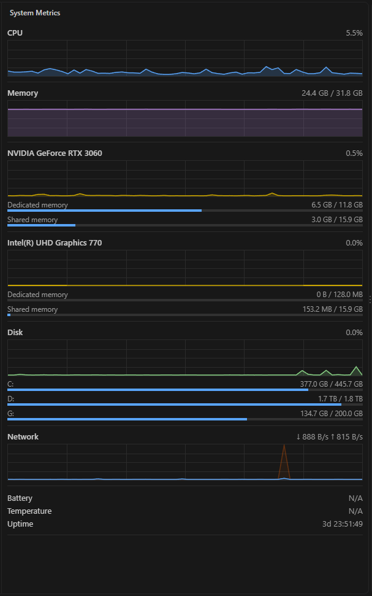

# System Metrics

Live system metrics in the VS Code sidebar, styled like the Windows Task Manager **Performance** tab.

Click the gauge icon in the activity bar to open the **System Metrics** view.

## What it shows

| Section                                | Shown as                                                                         | Updates                                                 |
| -------------------------------------- | -------------------------------------------------------------------------------- | ------------------------------------------------------- |
| CPU                                    | usage graph, optional per-core bars                                              | every second                                            |
| Memory                                 | usage graph, used / total                                                        | every second                                            |
| GPU (one section per physical adapter) | utilization graph with temperature, dedicated and shared memory bars             | every second on Windows, every 10 s elsewhere           |
| Disk                                   | activity graph, used / total bar per drive with its disk's temperature (Windows) | activity every second, space and temperature every 10 s |
| Network                                | download and upload graph                                                        | every second                                            |
| Footer                                 | battery, CPU temperature, uptime                                                 | every 10 s                                              |

Graphs keep the last 60 samples and follow your color theme. Anything a platform cannot report is shown as `N/A`.

## Settings

| Setting                   | Default | Description                                             |
| ------------------------- | ------- | ------------------------------------------------------- |
| `systemMetrics.showCores` | `false` | Show a usage bar for each CPU core under the CPU graph. |

## Platform notes

- **Windows:** GPU utilization works for any vendor and is reported per adapter (integrated and discrete separately). It comes from Windows performance counters, read by one background PowerShell process that runs only while the view is visible. GPU and disk temperatures come from the same process, through the Windows APIs that Task Manager and Settings > Disks use; no administrator rights are needed, and devices without a sensor (often integrated GPUs and USB drives) show `N/A`. A hard disk is asked for its temperature only while it is already busy with other work, so the extension does not keep it from spinning down; while it is idle, its last reading is shown with `(idle)`, and nothing is shown before the first one. When Windows cannot report per-disk activity (see non-English Windows below), hard disk temperatures stay `N/A`. CPU temperature is `N/A`, because Windows does not expose it without administrator rights or third-party tools.
- **macOS and Linux:** data comes from the [systeminformation](https://github.com/sebhildebrandt/systeminformation) library. GPU utilization and temperature are reported only for NVIDIA cards. Disk activity and disk temperatures are `N/A`.
- **Non-English Windows:** performance counter names are localized, so GPU, disk activity and network may show `N/A` when the Windows display language is not English.

## Resource use and privacy

Collection runs only while the view is visible and stops when you hide or close it. With the view open, the background counter process uses about 0.5% of total CPU on a 16-thread machine. The extension does not send data anywhere and makes no network requests.

## License

[MIT](LICENSE)
